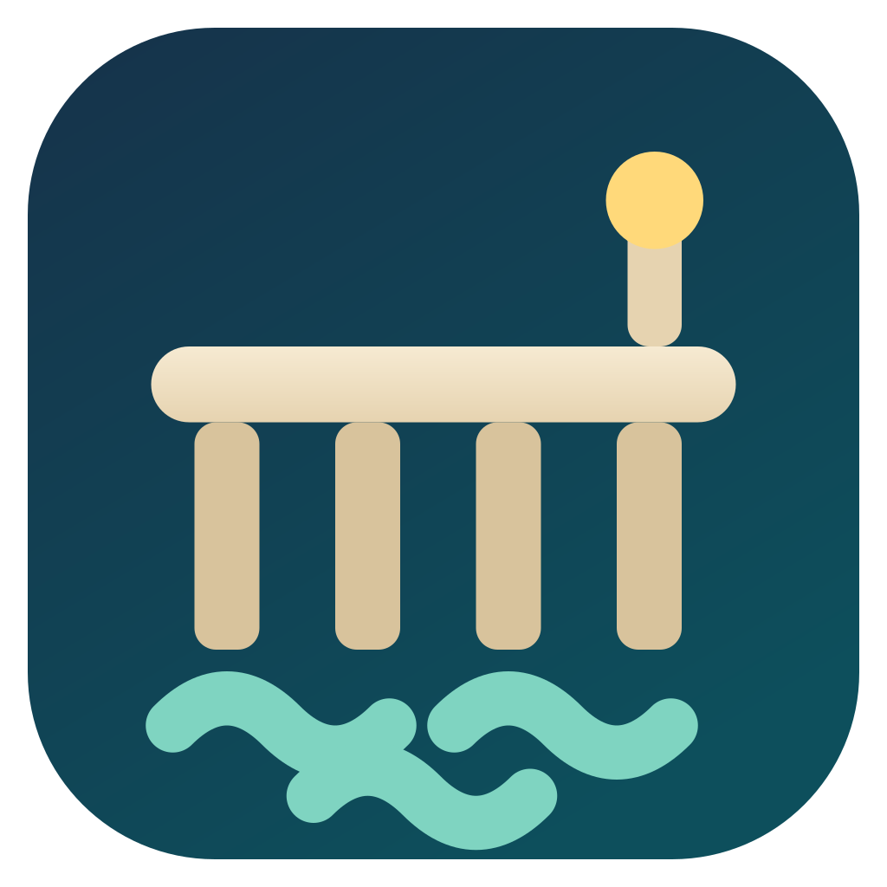

<div align="center">
  

  # Pier

  **See what is running on your Mac — and which agent started it.**

  A native macOS menu bar app for listening ports, AI agent attribution,
  containers, MCP servers, previews, logs, and process controls.

  [](https://github.com/shaaaaawn/pier/actions/workflows/ci.yml)
  
  
</div>

Pier answers the question that gets harder as agentic development gets busier:
**what owns this port, container, or background process?**

It inventories the work already running on your Mac, traces listening processes
back to AI coding harnesses and [cmux](https://github.com/manaflow-ai/cmux)
sessions, and puts the useful actions one click away.

## What Pier shows

- **Listening ports** — TCP and UDP listeners, deduplicated and grouped by owner.
- **Agent attribution** — Claude Code, Codex, Cursor, Kimi, OpenCode, and other
  known harnesses, plus cmux workspace and surface names.
- **Background activity** — Docker containers, Apple `container` workloads, and
  MCP server processes, including stopped containers.
- **Live context** — CPU history, command details, start/stop events, inline web
  previews, and available logs.
- **Direct controls** — open, copy, start, stop, kill, and explicit prune actions.

Pier is a menu bar app with no Dock icon. Search, scope filters, sorting, section
collapse state, panel size, and preview width persist between launches.

## Quick start

### Requirements

- macOS 13 or later
- Xcode 16 or later, including the Command Line Tools
- Optional: Docker Desktop, Apple
  [`container`](https://github.com/apple/container), and cmux

### Build from source

```sh
git clone https://github.com/shaaaaawn/pier.git
cd pier
make build
open dist/Pier.app
```

The local build is ad-hoc signed. macOS may ask you to confirm the first launch.
For day-to-day development, use:

```sh
make run      # rebuild and relaunch Pier
make check    # lint and run the test suite
```

See [Getting started](docs/getting-started.md) for first-run behavior and
[Development](docs/development.md) for the full build, test, fixture, and probe
workflow.

## How it works

Pier combines bounded local probes:

```text
lsof listeners ─┐
ps processes ───┼─> attribution ─> ports grouped by harness or cmux session
cmux sessions ──┘

docker / container / ps ─> containers and MCP server activity
```

Every external integration is optional. If Docker, Apple `container`, or cmux is
missing or unavailable, Pier keeps working and reports that source's state
without taking down the rest of the panel.

Read [Architecture](docs/architecture.md) for the collection pipeline and code
map.

## Privacy by design

Pier inspects sensitive local process information, so its boundaries are
deliberate:

- no telemetry, update checks, or background service API calls;
- no shell interpolation — subprocesses receive argument arrays;
- no command lines or environment variables written to Pier's log;
- previews use a non-persistent web view and block top-level navigation off-host;
- UI preferences and Pier's protected rotating log are the only disk writes.

Pier can display full process command lines in the UI and debug probes. Avoid
putting secrets in command-line arguments. Previewed pages can still request
their own remote subresources; see
[Privacy and security](docs/privacy-and-security.md) for the complete contract.

## Documentation

- [Documentation index](docs/index.md)
- [Getting started](docs/getting-started.md)
- [Features and limitations](docs/features.md)
- [Configuration](docs/configuration.md)
- [Troubleshooting](docs/troubleshooting.md)
- [Privacy and security](docs/privacy-and-security.md)
- [Architecture](docs/architecture.md)
- [Development and verification](docs/development.md)
- [Contributing](CONTRIBUTING.md)

## Project status

Pier is early-stage software built and tested on macOS. There is not yet a
notarized downloadable release.

The repository is being prepared for public open-source release. Two decisions
must be completed before publishing:

1. add an explicit software license; and
2. remove or clear redistribution of the bundled third-party brand icons.

Until a `LICENSE` file is added, the source is **not yet licensed for reuse**.

## Acknowledgements

Pier's status-item resilience and verification practices were informed by
[CodexBar](https://github.com/steipete/CodexBar). The app's pier glyph and
full-color icon live in [`assets/`](assets/).
